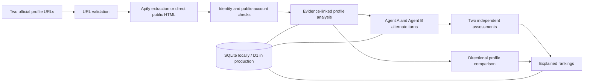

# Twofold

**Two public profiles. One evidence-backed agent. A conversation that changes the ranking.**

Twofold reads a person's LinkedIn and public Instagram, builds an inspectable profile, and lets their simulated agent meet another agent. Each agent proposes an activity, responds, adapts, and independently assesses the conversation. Rankings explain the documented overlap, the date's effect, and what remains unknown.

The people are real; the dialogue and assessments are simulations. The people shown have not participated in or endorsed these simulations. Twofold does not contact them.

## Try the product

Repository: [madaankartik/twofold-agentic-dating](https://github.com/madaankartik/twofold-agentic-dating).

Start with the [step-by-step local and Cloudflare deployment guide](docs/DEPLOYMENT.md), then use the [submission sheet and 2:45 recording script](docs/SUBMISSION.md). Deployment and the YouTube recording are performed by the project owner. Website and video URLs remain pending until verified.

Once the site is running:

1. Open **The people** and inspect a profile. Expand an interest to see its supporting LinkedIn or Instagram evidence.
2. Choose **Add a person**, paste their two official profile URLs, and follow the extraction and analysis progress.
3. Open **The dates**, choose two complete profiles and a scenario, and select **Start a live date**.
4. Watch four alternating turns and two independent assessments. Pause generation or replay a saved conversation at 1× or 2×.
5. Open **The matches**. Select a person, expand a result, and inspect its profile score, date adjustment, explanation, unknowns, and transcript.

Search and interest filters help explore the cohort. Original source links are available from both cards and profiles. Incomplete or unverified profiles cannot enter dates or rankings.

## What the 25-person example covers

The checked-in example contains **25 people and 25 completed distinct dates**, giving each person two different partners. Each date has four conversation turns and two separate assessments: 100 dialogue turns and 50 verdicts. The saved totals are recorded in [demo-verification.json](data/demo-verification.json) and can be checked with `npm run seed:check`.

Each person receives an ordered list of the other 24 people: **600 directional ranked comparisons**. There are 300 possible unordered pairs; the baseline does **not** claim that all 300 have dated. Completed dates are labeled **Met**. Other entries are explicitly preliminary profile comparisons.

The website displays the actual saved completion counts. Use the release checks in [SUBMISSION.md](docs/SUBMISSION.md) to verify the final run before claiming these totals in a submission.

## Architecture



| Layer | Implementation |
| --- | --- |
| Interface | React 19, TypeScript, Vite, custom CSS, Lucide icons |
| API | Hono with the same application running on Node locally and a Cloudflare-compatible Worker in production |
| Storage | SQLite locally; a D1 `DB` binding in production; Drizzle-managed SQL schema |
| Extraction | Apify `harvestapi/linkedin-profile-scraper` and `apify/instagram-profile-scraper`; direct public HTML fallback when Apify is not configured |
| Analysis and dialogue | Groq Chat Completions; default model `openai/gpt-oss-120b`; strict JSON output and Zod validation |
| Offline model fallback | Clearly labeled deterministic, evidence-based negotiation rules when no Groq key is configured |

### Exactly two sources

All person-specific evidence comes from that person's own LinkedIn and Instagram. Apify is an extraction service, not an additional biographical source. Candidate discovery can locate accounts, but outside biographies, articles, search commentary, and inferred private details do not enter the profile evidence.

An observation retains its platform, original URL, extraction timestamp, access method, and evidence ID. Analysis traits cite those IDs and carry `observed` or `tentative` status plus high, medium, or low confidence. The model's profile output is rejected if it cites evidence IDs it was not given.

Instagram must be explicitly confirmed public. The direct adapter inspects the official public embed's own-media owner and checks `is_private === false`; a visible bio alone is insufficient. The Apify adapter checks the returned public/private field. Captions are limited to posts attributed to the profile owner when the owner field is available.

Live identity checks use names, matching handles or roles, and explicit cross-links where present. This is a practical consistency check, not formal identity verification. The prepared cohort is also manually cross-checked. The form asks for profiles belonging to the same adult; it does not perform age verification.

### What an agent knows

Each model turn receives its person's evidence and traits, the other person's name and interest labels, the scenario, and the conversation so far. A separate call generates each turn. Each assessment gets the person's own evidence and the completed conversation; the other agent's assessment is not supplied.

The four stages are **Opening → Exploring → Adapting → Decision**. Agents choose among concrete activity proposals such as a gallery, bookshop, food market, walk, café conversation, acoustic set, or garden.

The prompt treats profile text and dialogue as untrusted data. It forbids inventing intimate preferences, availability, mental health, or unstated personal boundaries. Public content topics are not automatically hobbies. Relationship needs remain unknown unless actually established; the profile instead offers questions for the real person.

Generated messages are always presented as an agent simulation. An agent's response provides evidence about the simulation, not new facts about the person. No messages are sent to LinkedIn, Instagram, email, or the people represented.

### How ranking works

The base fit index compares documented topics in both directions, with more weight on the person whose ranking is open. Related labels are mapped to shared topics: for example, investing and financial education map to Finance, and UX Design maps to Design. Specific compounds are considered first: Food Photography maps to Photography without adding an unsupported interest in cooking. Original labels and citations stay on the profile. Duplicate topics contribute only their strongest supported instance.

Each topic gets a weight based on its category and evidence:

| Factor | Weight |
| --- | --- |
| Hobby / priority / interest | 1.25 / 1.1 / 1 |
| High / medium / low confidence | 1 / 0.8 / 0.55 |
| Tentative observation | Multiply by 0.65 |
| Broad career topic: entrepreneurship, finance, technology, marketing or leadership | Multiply by 0.65 |

These factors are multiplied. Coverage is the weight of a person's shared topics divided by the weight of all their topics.

```text
coverageA = weight of A's shared topics / weight of all A's topics
coverageB = weight of B's shared topics / weight of all B's topics
base = min(90, round(30 + 50 × coverageA + 10 × coverageB))
```

If the only shared topics concern careers, the base is capped at 68. If either profile has no topics, the base is zero. This is an inspectable heuristic, not a calibrated probability of romantic success. A zero from missing evidence means insufficient information.

For a completed model date, A's independent assessment adds a bounded **−10 to +10** adjustment, clamped to a final score between 0 and 100. Ranking recomputes the current profile base and applies the saved directional adjustment. The latest completed date for a pair supplies the displayed assessment; unfinished dates do not affect rankings. A→B and B→A can differ.

The rules engine uses the same profile comparison and an activity-fit adjustment of −4, +4, or +8. It marks extracted content interests as tentative and low confidence. Engine labels remain visible; a failed model call is not silently replaced by a rules result.

Ranking evidence coverage is labeled **Moderate** when both profiles have at least four observations and at least two shared topics with medium or high confidence on both sides; otherwise it is **Limited**. These are simple coverage labels, not statistical confidence intervals.

### Persistence, retries, and limits

- Ingestion jobs persist the links, current stage, provider run IDs, intermediate results, and error state.
- The browser advances a job one step at a time. Its URL contains the job ID, so reloading that URL can resume within the same browser session. This is not an unattended background queue.
- Date messages and assessments are saved after each successful step. Model rate limits save a cooldown and resume when the browser's timer reaches it. Other model or source failures expose a retry control and keep completed progress.
- Per-job and per-date database locks prevent overlapping advancement. A lock expires after 90 seconds.
- Re-entering an already visible URL pair returns the saved profile. That cache is not automatically refreshed.
- Prepared demo records are shared and read-only. New records are scoped to an HTTP-only browser-session cookie; this is session isolation, not a full account system. The cookie lasts seven days.
- Ingestion permits eight requests per session per hour and 80 globally per day. New live dates permit 12 per session per hour and 120 globally per day. Provider limits may be lower; errors remain visible.
- Source or model access failures do not produce fabricated profiles. Images use initials as a fallback if the source image expires or fails to load.

## Run locally

Use **Node.js 22.13 or later**; the local backend uses the built-in `node:sqlite` module.

```bash
npm ci
cp .env.example .env.local
npm run dev
```

Open `http://127.0.0.1:5173`. Vite proxies `/api` to the API at `http://127.0.0.1:8787`. The API applies the SQL migrations and creates `data/local.db` on first startup.

Set these values in `.env.local` as needed:

| Variable | Purpose |
| --- | --- |
| `APIFY_TOKEN` | Enables the two hosted scraping actors. Recommended for LinkedIn, which commonly blocks direct requests. |
| `GROQ_API_KEY` | Enables model-based analysis, dialogue, and independent assessments. |
| `GROQ_MODEL` | Optional model override; defaults to `openai/gpt-oss-120b`. Use a model supporting the required JSON schema. |
| `ADMIN_TOKEN` | A strong random value required only to import the prepared demo through the admin endpoint. |
| `PORT` | Optional local API port; defaults to 8787. Update the Vite proxy if changed. |

Without provider keys, the API still runs and the rules engine works with restored verified demo profiles. Fresh ingestion still needs readable content from both platforms; direct LinkedIn requests may fail. The app reports that failure rather than pretending it read the profile. Services use the owner's configured accounts and quotas; Twofold does not purchase credits.

### Restore the prepared demo from a clean clone

Start the API first, set `ADMIN_TOKEN`, and confirm both `data/demo-people.json` and `data/demo-dates.json` are present in the release. Then run from the project root:

```bash
npm run seed:check
npm run seed:import
```

Refresh the website. The importer validates at least 25 ready profiles, valid citations, complete dates, and two different partners per person before writing anything. It writes batches of 20 records and verifies public readback. Re-running is safe by record ID and requires no scraping or model calls. Credentials come from `.env.local` or the environment. For a deployed site, use `npm run seed:import -- --url https://YOUR-ACTUAL-ORIGIN`.

### Regenerate the cohort from its official links

`data/cohort.json` contains the 25 official URL pairs. To fetch them again and generate fresh model profiles and dates, start the local API once so its migrations create the database, configure your Apify and Groq keys, then run:

```bash
node --import tsx scripts/fetch-cohort.ts
npm run seed
node --import tsx scripts/finalize-demo.ts
npm run seed:check
```

The source fetcher batches LinkedIn profiles and resumes saved Apify run IDs. It stores raw provider responses under ignored `data/private/`. The model runner resumes saved profiles and conversation steps in `data/local.db`. Finalization requires exactly 25 completed dates, two dates per person, and 600 rankings; it updates saved verdict scores to the current scoring formula and exports `data/demo-verification.json` alongside the compact demo files.

This generation path uses your provider quota and may take time. Check the actor's current price and your account's remaining credits first. Restoring the checked-in demo uses no provider calls. To intentionally regenerate already cached records, use a separate clean checkout/database so the resumable runner does not return earlier work.

### Build and test

```bash
npm run check
npm test
npm run build
```

The build emits the frontend into `dist/client/` and a self-contained Worker module into `dist/server/index.js`. `wrangler.jsonc` serves the frontend through Cloudflare Static Assets and sends `/api/*` to the Worker with its D1 `DB` binding. The bundle retains embedded assets for compatible alternate hosts. Follow [DEPLOYMENT.md](docs/DEPLOYMENT.md) to replace the database placeholder, add server secrets, apply migrations, deploy, and import the demo.

`npm start` runs the local API. Use `npm run dev` for the local browser UI. No production host, account, or deployment URL is assumed by these commands.

Tests cover URL allowlisting, cautious extraction, identity matching, public Instagram verification, directional scores, 25-person date coverage, and complete rankings. A passing unit suite does not replace a real fresh-link extraction and deployed browser check.

## API overview

| Method | Path | Purpose |
| --- | --- | --- |
| GET | `/api/health` | Configured engine, connection flags, and visible saved counts |
| GET / POST | `/api/people` | List visible profiles / begin an ingestion job |
| GET | `/api/people/:id` | Read an evidence-linked profile |
| GET | `/api/people/:id/rankings` | Compute that person's directional ranking |
| GET | `/api/jobs/:id` | Read the owner's ingestion progress |
| POST | `/api/jobs/:id/advance` | Execute or retry the next ingestion step |
| GET / POST | `/api/dates` | List visible dates / start a new simulated date |
| GET | `/api/dates/:id` | Read a saved or running date |
| POST | `/api/dates/:id/advance` | Generate or retry the next turn or assessment |
| POST | `/api/admin/seed` | Import prepared demo records with bearer authorization |

The health connection flags indicate configuration, not a live provider availability check.

## Repository map

```text
src/                  React interface, custom CSS, shared types
server/app.ts         HTTP API and persisted orchestration
server/domain.ts      Validation, fallback agents, scheduling, scoring
server/sources.ts     Apify and direct-source adapters
server/llm.ts         Model prompts, JSON schemas, citation validation
server/store.ts       Storage, locks, and rate counters
db/ + drizzle/        Schema and migrations
scripts/              Build, demo import and original cohort-generation utilities
data/demo-*.json       Compact public demo records, when run is complete
data/cohort.json       The 25 matched official LinkedIn/Instagram URL pairs
tests/                Behavioral tests
docs/SUBMISSION.md    Delivery checklist, final copy, and video script
docs/DEPLOYMENT.md    Local setup, Cloudflare D1 deployment, and troubleshooting
wrangler.jsonc        Worker, static assets, and D1 configuration
```

Do not commit `.env.local`, API tokens, local SQLite databases, provider run dumps, `data/private/`, or raw research HTML. The public release contains only the deliberately selected public-source evidence and simulated results needed to inspect the assignment.
